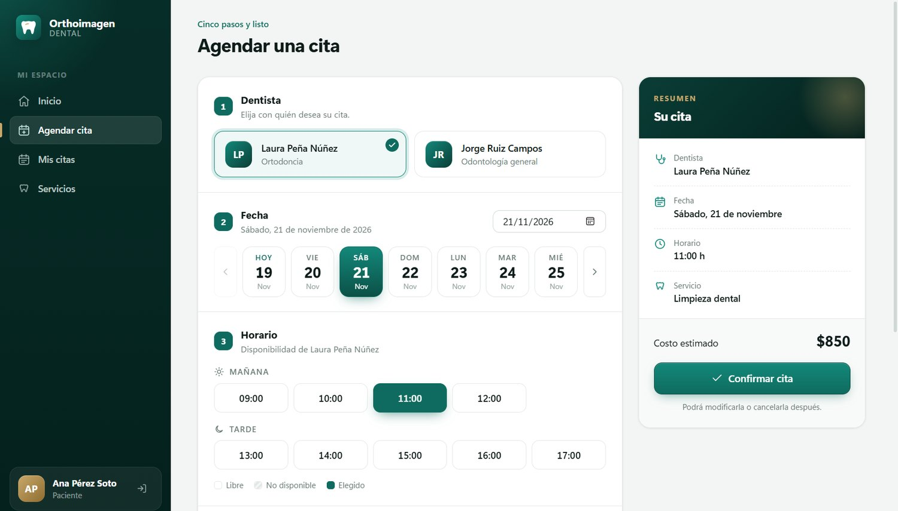

# Orthoimagen Dental · Sistema de citas

Proyecto de **Desarrollo de Aplicaciones y Servicios Virtuales** (Universidad Iberoamericana León).
Equipo: **Matias Ochoa Tirado** y **Mateo Javier Ortega Fernández**.

Aplicación de escritorio para Windows que permite a los pacientes crear su cuenta y agendar en cinco
pasos, a recepción administrar pacientes, accesos y la agenda completa, y a cada dentista ver su
jornada. Los datos se guardan en SQLite. Incluye también una versión de consola que usa los mismos
módulos.



📘 **Manual de usuario:** [docs/manual/Manual_Orthoimagen_Dental.pdf](docs/manual/Manual_Orthoimagen_Dental.pdf)
(instrucciones para pacientes nuevos y de siempre, recepción y dentistas).

## Cómo ejecutar

**Opción 1 · Ejecutable (recomendada, sin instalar Python):** descarga `OrthoimagenDental.exe` desde
la sección *Releases* y ábrelo con doble clic. La base se crea en la carpeta `data`, junto al `.exe`.
La primera vez, Windows SmartScreen puede advertir que el archivo no está firmado: elige *Más
información → Ejecutar de todas formas*.

**Opción 2 · App de escritorio desde el código** (Python 3.10 o superior):

```powershell
py -m pip install -r requirements.txt
```

```powershell
py app_escritorio.py
```

**Opción 3 · Consola** (solo biblioteca estándar):

```powershell
py main.py
```

**Opción 4 · Navegador, para desarrollo:** `py -m interfaz.servidor_dev` y abrir http://127.0.0.1:8765

Para usar otra base de datos, define la variable de entorno `ORTHOIMAGEN_BD`. Para ocultar los
botones de usuarios de demostración en una instalación real, define `ORTHOIMAGEN_DEMO=0`.

### Usuarios de demostración (solo entorno local)

| Usuario | Contraseña | Rol |
|---------|-----------|-----|
| `recepcion01` | `Recepcion#2026` | recepcionista |
| `paciente01` | `Paciente#2026` | paciente (Ana Pérez Soto) |
| `paciente02` | `Paciente#2026` | paciente (Luis Gómez Vega) |
| `dentista01` | `Dentista#2026` | dentista (Laura Peña Núñez) |
| `dentista02` | `Dentista#2026` | dentista (Jorge Ruiz Campos) |

Se definen en `modules/demo_data.py`. Las contraseñas se guardan con hash PBKDF2-SHA256.

## Clientes nuevos y clientes de siempre

| Caso | Qué hace el sistema |
|------|---------------------|
| Cliente nuevo | Crea su cuenta en "Soy paciente nuevo", o recepción lo registra con o sin acceso. |
| Cliente de siempre sin usuario | Recepción le crea el acceso ligado a su expediente; si intenta registrarse con el mismo teléfono, el sistema lo remite a recepción para no duplicarlo. |
| Contraseña olvidada | Recepción la restablece; el usuario y las citas no cambian. |

## Qué puede hacer cada rol

| Rol | Opciones |
|-----|----------|
| Paciente | Inicio con su próxima cita, agendar en 5 pasos, mis citas (próximas e historial), modificar, cancelar y servicios |
| Recepción | Panel del día, nueva cita para cualquier paciente, agenda con filtros, modificar (incluso el dentista), cancelar, eliminar, pacientes y accesos, servicios |
| Dentista | Jornada del día con indicadores, agenda día por día y servicios |

Reglas principales: un dentista no puede tener dos citas activas a la misma hora (RF-02, reforzado
con un índice único en la base); cancelar deja la cita en el historial con estatus "Cancelada" y
libera el horario; eliminar borra el registro y solo lo hace recepción. Horario de atención: bloques
de 60 minutos de 09:00 a 18:00 (supuesto configurable en `config/settings.py`).

## Cómo ejecutar las pruebas

```powershell
py -m unittest discover -v
```

Resultado actual: **177 pruebas, 0 fallidas**. No requieren pywebview ni abrir ventanas.

## Cómo generar el ejecutable

```powershell
powershell -ExecutionPolicy Bypass -File construir_exe.ps1
```

Corre las pruebas, instala PyInstaller y pywebview en `.venv-build` y deja el archivo en
`dist\OrthoimagenDental.exe`.

## Estructura

```
app_escritorio.py               App de escritorio: ventana nativa (pywebview + WebView2)
interfaz/web/                   Interfaz: index.html, estilos.css (sistema de diseño), app.js
interfaz/api.py                 Puente interfaz ↔ módulos (sin reglas de negocio)
interfaz/servidor_dev.py        Servidor local para ver la interfaz en el navegador
main.py                         Consola: login, cuenta nueva y menú por rol
construir_exe.ps1               Genera el .exe con PyInstaller
config/settings.py              Ruta de la base, horario de atención y modo demo
modules/validation_messages.py  M6 Validación y mensajes (RF-10)
modules/data_access.py          M7 Acceso a datos SQLite (RF-09)
modules/auth_roles.py           M1 Autenticación y roles (RF-11)
modules/service_catalog.py      M5 Catálogo de servicios (RF-08)
modules/availability.py         M3 Disponibilidad (RF-07, RF-02)
modules/appointments.py         M2 Gestión de citas (RF-01, RF-03, RF-04, RF-05)
modules/agenda.py               M4 Consulta de agenda (RF-06)
modules/patients.py             M8 Registro de pacientes y accesos (RF-12 propuesto)
modules/demo_data.py            Datos de demostración
tests/                          Pruebas unittest por módulo y de extremo a extremo
docs/manual/                    Manual de usuario (PDF, HTML y capturas)
docs/especificaciones.md        RF, HU, CA y arquitectura consolidados
docs/plan_incrementos.md        Plan de incrementos, ambigüedades y registro de cambios
docs/matriz_trazabilidad.md     RF → código → commits → pruebas
docs/bitacora_ia.md             Uso de IA y decisiones del equipo
docs/guia_explicacion_codigo.md Qué explica cada integrante y cómo funciona cada módulo
```

## Versiones

| Versión | Tag | Contenido |
|---------|-----|-----------|
| Incremento 1 | `v0.1.0` | Mensajes claros de error (RF-10) |
| Incremento 2 | `v0.2.0` | SQLite, inicio de sesión con roles y catálogo de servicios (RF-09, RF-11, RF-08) |
| Incremento 3 | `v0.3.0` | Disponibilidad, citas sin empalmes y registro de citas (RF-07, RF-02, RF-01) |
| Incremento 4 | `v0.4.0` | Consultar, modificar, cancelar y eliminar citas (RF-06, RF-03, RF-04, RF-05) |
| Entrega final | `v1.0.0` | App de escritorio por rol y ejecutable para Windows |
| Versión 1.1 | `v1.1.0` | Pacientes nuevos y accesos (RF-12 propuesto), interfaz rediseñada y manual de usuario |
